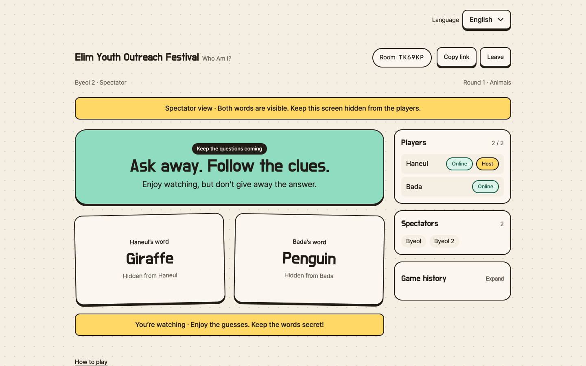
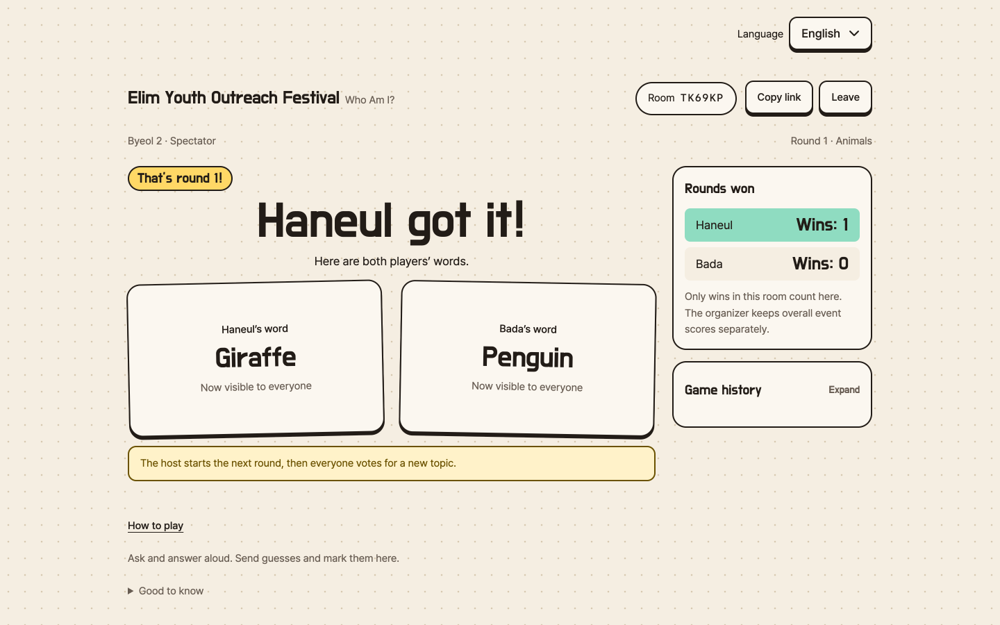

<strong>ELIM PLAY</strong>

<h1 align="center">They know. You guess.</h1>

A guessing game for a room: two players each carry a word only they cannot see, the questions are asked out loud, and the whole room watches both words.

<a href="https://elimplay.pages.dev"><b>Play Elim Play →</b></a>

One round played on the game's own server in a local run by made-up players (Haneul, Bada and Byeol), in the English interface, on 14 November 2026. The reveal is the game's own animation, stepped frame by frame. <a href="assets/elim-play-promo-20261114.mp4">Watch the full film</a> · <a href="assets/elim-play-promo-20261114-poster.png">Still frame</a> · <a href="assets/elim-play-promo-20261114-manifest.json">Capture details</a>

## Everyone knows but you

Each player's own word is hidden from them and shown to everyone else. Ask away, follow the clues; the spectators watch both words and keep the secret.

## Then both cards turn

When a player guesses, the other judges, and the game reveals both words to everyone.

Made-up players in a local run. The event name on screen is the game's own default.

## Development status

Elim Play is live at [elimplay.pages.dev](https://elimplay.pages.dev), in Korean and English. The source code is private.

---

[More projects by Hyunjun Kim](https://github.com/EricEremos) · [Get in touch](https://www.linkedin.com/in/ericmos/)
